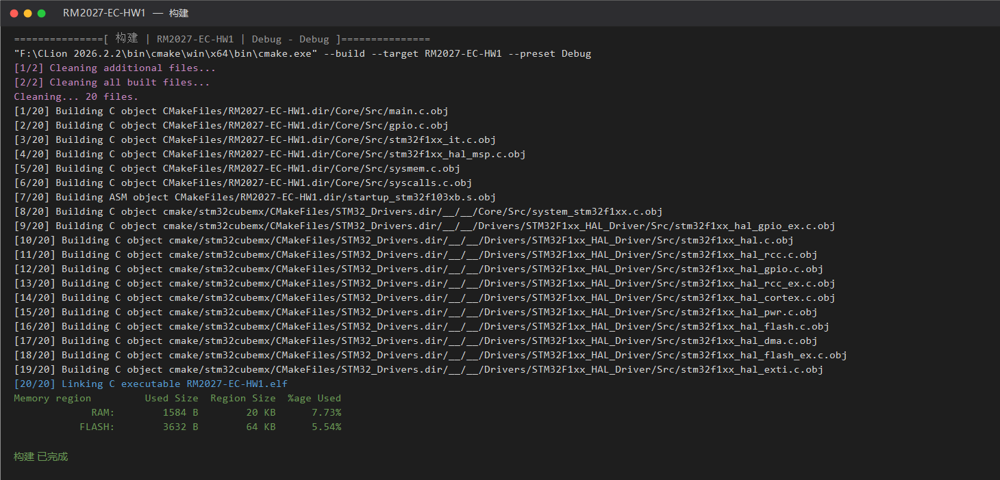

# 电控组首次培训作业

- **陈金泽**
- ***20263006501***

## 环境

- STM32CubeMX 6.15.0 + STM32Cube FW_F1
- CLion 2026.2.2 + arm-none-eabi-gcc 10.3.1
- OpenOCD + ST-Link

## 工程

- 芯片：STM32F103C8Tx（LQFP48，64 KB Flash / 20 KB RAM）
- 时钟：HSE 8 MHz → PLL ×9 → 72 MHz
- 调试：SYS → Serial Wire（SWD）

## 编译结果

```
[20/20] Linking C executable RM2027-EC-HW1.elf
[100%] Built target RM2027-EC-HW1
Build finished
```


